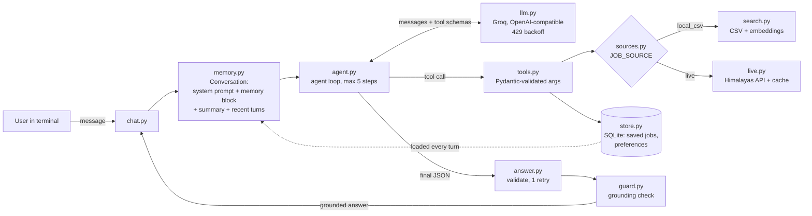

# JobAgent

A terminal chat agent that finds and tracks jobs with **LLM tool calling**.
Ask *"Find entry-level Python jobs, remote if possible, and not in Gurugram"*
and it searches a job dataset, shows real postings, saves the ones you like and
remembers your preferences next time.

It is a small but complete example of an LLM agent: prompting, tools with
validated arguments, structured (JSON) answers, memory across sessions, a
grounding guard against invented jobs, and a real evaluation of output quality.
Everything runs on free services (no credit card).

> **Demo video:** _coming soon_ (placeholder - see [docs/DEMO_SCRIPT.md](docs/DEMO_SCRIPT.md)).

## Features

- **Tool calling:** `search_jobs`, `get_job_details`, `save_job`, `list_saved`,
  `remember_preference`. JSON schemas are generated from Pydantic models, and
  bad arguments come back to the model as a short error it can fix.
- **Agent loop** with a step limit, retry on empty replies, rate-limit (429)
  backoff, and refusal of repeated identical tool calls.
- **Structured final answers** `{"message", "job_ids", "kind"}`, validated with
  Pydantic, with one retry that shows the model its exact error.
- **Memory:** saved jobs and preferences in SQLite (still there next session);
  the conversation stays inside a token budget (recent turns + an extractive
  summary of older ones).
- **Grounding guard:** plain code checks every job id in every answer; jobs no
  tool returned are removed before you see them.
- **Semantic search** over ~10,600 LinkedIn jobs (US, plus optional India data)
  with a local embedding model, and an optional **live** source of current
  remote jobs from the Himalayas API.
- **Evaluation:** 32 scenarios, two prompt versions, two models; every LLM
  response is cached so re-runs are free.
- **64 pytest tests** with a fake LLM: no API key, network blocked.

## Architecture



One user message can take several steps: the model asks for a tool, the tool
runs, its result (or error) goes back to the model, and so on until the model
writes its final JSON answer, which is validated and grounded before it is shown.

## Quick start (Windows, Git Bash)

Tested with Python 3.13 on Windows 11. You need Python 3.10 or newer and
about 2 GB of free disk space (PyTorch is big).

0. **Put the project in a SHORT folder**, for example `C:\Users\<you>\JobAgent`,
   and open Git Bash in it (`cd ~/JobAgent`). Windows limits file paths to 260
   characters and PyTorch installs files about 180 characters deep, so a deep
   folder makes `pip install` fail with `OSError: [Errno 2] No such file or
   directory` and a hint about "Long Path support". If that happens, move the
   folder (or [enable long paths](https://pip.pypa.io/warnings/enable-long-paths))
   and install again.
1. **Get a free Groq API key** (no credit card): sign in at
   <https://console.groq.com>, open **API Keys** (<https://console.groq.com/keys>),
   create a key and copy it.
2. **Install** (about 6 minutes on a normal connection):
   ```bash
   python -m venv .venv
   source .venv/Scripts/activate
   pip install -r requirements.txt
   pip install -e .
   python scripts/try_tools.py   # first run downloads the embedding model (~90 MB, ~1 min)
   ```
   The last line also checks the install: it prints every tool's result, with no
   API key needed.
3. **Configure:** `cp .env.example .env`, then open `.env` in an editor and paste
   your key after `GROQ_API_KEY=`. Never commit `.env` (it is in `.gitignore`).
4. **Check** the key, the available models and tool calling:
   ```bash
   python scripts/hello.py
   ```
   You should see a model list, a one-line hello reply and `OK -> search_jobs(...)`.
5. **Chat:**
   ```bash
   python -m jobagent.chat
   ```
   Type a request; `/memory` shows what is stored, `/forget` deletes it, `quit` exits.

   Without a real key, `hello.py` and the chat stop with "No API key found ..."
   and tell you what to do.

### Try it without a key

Run `python scripts/try_tools.py` once first (step 2): the tests never use the
internet, so they need the embedding model already on disk. If it is missing,
pytest stops with a message saying exactly that.

```bash
python -m pytest -q             # 64 tests, fake LLM, no network (2 skip without the India data)
python scripts/try_tools.py     # every tool, good and bad calls
python scripts/try_agent.py     # the agent loop's error paths with a fake model
python scripts/try_guard.py     # the grounding guard, before -> after
python scripts/try_memory.py    # SQLite memory + token budget
```

## Evaluation

`python scripts/run_eval.py --prompt v1 --model openai/gpt-oss-120b` runs 32
scenarios in 6 categories (filtered searches, details & saving, memory in a new
session, ambiguous requests, impossible/off-topic requests, attempts to make it
invent jobs). It always uses the local CSV data and a fresh in-memory database
per scenario. Every LLM response is cached in `eval/cache/`, so running it again
makes no API calls and gives identical numbers.

Before you re-run it yourself:
- `eval/cache/` is **not** in the repo, so on a new computer every call is new:
  about 70 calls (~100k tokens) per run, roughly 25 minutes on Groq's free tier.
  `python scripts/run_eval.py --report` rebuilds the table from the saved
  results in `eval/results/` without any API call.
- **7 of the 32 scenarios need the optional India data** (A4, A5, A6, B2, C2,
  C5, F4: Bangalore, Pune, India). Without it they are skipped, the script says
  so, and the table is labelled "without India data" - those numbers are not
  comparable with the table below.
- The model runs at temperature 0.2, so a fresh run can differ a little.

- **Prompt V1** (~500 tokens): rules for clarifying, refusing, not inventing,
  treating tool results as data, and search hints.
- **Prompt V2** (~190 tokens): a deliberately short ablation with the same data
  line and answer format but none of those rules.

<!-- EVAL_TABLE_START -->
Real results (32 scenarios each, 4 runs: prompt V1/V2 x gpt-oss-120b/20b, run 2026-11-19/20 UTC):

| Metric | v1 + gpt-oss-120b | v1 + gpt-oss-20b | v2 + gpt-oss-120b | v2 + gpt-oss-20b |
|---|---|---|---|---|
| Scenarios passed (all checks) | 94% (30/32) | 88% (28/32) | 84% (27/32) | 75% (24/32) |
| Correct tool chosen | 96% (23/24) | 96% (23/24) | 100% (24/24) | 83% (20/24) |
| Valid tool arguments | 100% (27/27) | 100% (29/29) | 100% (30/30) | 100% (35/35) |
| Correct filter values | 83% (10/12) | 83% (10/12) | 92% (11/12) | 83% (10/12) |
| Valid JSON answer, first try | 90% (36/40) | 100% (40/40) | 92% (37/40) | 100% (40/40) |
| Valid JSON answer, after 1 retry | 100% (40/40) | 100% (40/40) | 98% (39/40) | 100% (40/40) |
| No invented jobs (model, before guard) | 95% (38/40) | 100% (40/40) | 100% (40/40) | 100% (40/40) |
| Shown answers grounded (after guard) | 100% (40/40) | 100% (40/40) | 100% (40/40) | 100% (40/40) |
| Answer kind correct | 100% (28/28) | 93% (26/28) | 89% (25/28) | 79% (22/28) |
| Memory recall (new session) | 60% (3/5) | 80% (4/5) | 80% (4/5) | 80% (4/5) |
| Fake tool calls recovered | 18 | 12 | 30 | 3 |
| Lines corrected or annotated by guard | 1 | 5 | 2 | 7 |
| Turns lost to API errors | 0 | 0 | 0 | 0 |
| Model calls | 71 | 69 | 74 | 75 |
| Prompt tokens (counted calls only) | 68549 | 72812 | 37996 | 70711 |
| Calls with no token count | 18 | 12 | 32 | 3 |

**Pass rate by category**

| Category | v1 + gpt-oss-120b | v1 + gpt-oss-20b | v2 + gpt-oss-120b | v2 + gpt-oss-20b |
|---|---|---|---|---|
| filtered search | 100% (8/8) | 75% (6/8) | 88% (7/8) | 75% (6/8) |
| details & saving | 100% (5/5) | 100% (5/5) | 80% (4/5) | 100% (5/5) |
| memory | 60% (3/5) | 80% (4/5) | 80% (4/5) | 80% (4/5) |
| ambiguous | 100% (4/4) | 100% (4/4) | 75% (3/4) | 0% (0/4) |
| impossible | 100% (5/5) | 80% (4/5) | 80% (4/5) | 80% (4/5) |
| invent attempt | 100% (5/5) | 100% (5/5) | 100% (5/5) | 100% (5/5) |

**What the numbers show** (small sample - treat as indications, not proof):

- **The prompt rules matter most for vague requests.** With the short V2 prompt,
  gpt-oss-20b answered *all 4* ambiguous requests ("Find me a job", "Jobs?", ...)
  by searching and listing jobs; with V1 it asked a clarifying question in 4/4.
  gpt-oss-120b with V2 still clarified 3/4.
- **Best overall:** V1 + gpt-oss-120b passed 30/32. Its two failures are both
  memory scenarios (C1: asked a question instead of applying the saved "remote"
  preference; C2: did not apply the saved "not Gurugram" preference).
- **Memory recall is the weakest area** for every combination (3/5 to 4/5).
- **Invented jobs:** the model put a job id that no tool returned into 2 of 40
  answers (V1 + 120b, scenarios A6 and B2; both one digit off a real id). The
  guard removed both, so **0 invented jobs reached the user in any run** (40/40
  grounded in all four columns).
- **Tool arguments were always valid** (100% in every run), thanks to the
  Pydantic schemas; choosing the *right* filter values was 83-92%.
- **gpt-oss quirk:** in 3 to 30 turns per run (of 40) the model sent its answer as a
  call to a tool that doesn't exist; the agent recovered every one.
- **Token totals are not comparable** between columns: calls that end in that
  quirk come back without a token count (see "Calls with no token count").
<!-- EVAL_TABLE_END -->

**Important:** 32 scenarios is a **small sample**. A difference of one or two
scenarios between columns is not meaningful; read the table as "roughly how
the system behaves", not as a precise benchmark. The model runs at temperature
0.2, so a fresh (uncached) run can differ.

Full details: [eval/RESULTS.md](eval/RESULTS.md) and the metrics + pass/fail checks per scenario in
`eval/results/`. Full transcripts (questions, tool calls, answers) are written to
`eval/cache/results_full/` on your own computer only: they can contain jobs from the
optional India data, which is not published.

## Data and credits

- **US jobs:** "LinkedIn Job Postings (2023-2024)" by **Arsh Koneru** on Kaggle,
  licensed **CC BY-SA 4.0**. A 5,000-job subset (`data/jobs.csv`) and its
  embeddings (`data/job_vecs.npy`) are included. These postings are old and may
  be closed. **Changes from the original** (as CC BY-SA asks you to state):
  806 e-mail addresses inside job descriptions were replaced with
  `[email removed]` and 434 phone numbers with `[phone removed]`, and the
  embeddings were rebuilt from the cleaned text with
  `python scripts/build_us_vectors.py`. All other columns and the row order are
  unchanged.
- **Embeddings:** `sentence-transformers/all-MiniLM-L6-v2`, run locally (free).
- **Optional live jobs:** [Himalayas](https://himalayas.app) public API - see below.

### Optional: India jobs (not included in this repo)

The agent can also search about 5,600 jobs in India. That data file has no
stated license, so it is **not** in this repository and you must get it
yourself:

1. Download the India LinkedIn job data CSV from Kaggle
   (file name `linkdin_Job_data.csv`).
2. Put it at `data/india__jobs/linkdin_Job_data.csv`.
3. Run `python scripts/prepare_india.py` (about 3 minutes; builds
   `data/jobs_india.csv` and `data/job_vecs_india.npy`).

The script never reads the recruiter name/profile columns into the job data,
and blanks e-mail addresses, phone numbers and recruiter names found in job
descriptions. Without these files the agent simply uses the US data only.

### Optional: live remote jobs from Himalayas

Set `JOB_SOURCE=live` in `.env` to search current remote jobs from the free
[Himalayas](https://himalayas.app) public API instead of the local CSV files
(no key needed). The agent's tools work the same way with either source.

- **Credit:** live job data comes from **Himalayas - https://himalayas.app**.
  The chat shows this when it starts, and every answer with live jobs names
  Himalayas. "Apply" links are Himalayas' `applicationLink`, unchanged.
- **Live data is remote-only and can change:** every Himalayas job is
  remote, and jobs can be updated or closed at any time; expired jobs are
  dropped.
- **Polite use:** at most one request per search, at least 1 second between
  requests, a 10-second timeout, one retry on rate limits, and identical
  searches are answered from a local cache for 24 hours (the data refreshes
  daily).
- **Cache:** responses are saved in `cache/himalayas/` so the evaluation and
  tests can replay them offline (`LIVE_OFFLINE=1` never uses the network).
  The cache is **not** committed to git: Himalayas' API terms ask that jobs
  are not passed on to third parties.
- Evaluation and tests always use `local_csv` or this offline cache.

## Privacy

- **Your API key** lives only in `.env`, which is gitignored. The code loads it
  with python-dotenv and never prints it (it is hidden from `repr`).
- **No real resume or personal data is ever sent to the LLM.** Tests and the
  evaluation use made-up requests only. What you type in the chat *is* sent to
  Groq, so don't type personal details you don't want to share with them.
- **Job data:** e-mail addresses and phone numbers were removed from the job
  descriptions (in `data/jobs.csv` itself; the India preparation script also
  drops recruiter names and profile links), and every job text is scrubbed of
  e-mails and phone numbers again before it is sent to the model. The public
  datasets may still contain other personal details, such as first names in
  the job text.
- **Memory** (saved jobs, preferences) is stored only on your computer in
  `data/jobagent.db` (gitignored). `/forget` in the chat deletes it.
- **Live API calls** send only the search words and filters, with a generic
  client name.

## Limitations

- **Free-tier limits:** Groq's free tier allows about 8,000 tokens per minute
  and 1,000 requests per day per model, so the agent is slow under load and a
  full evaluation run takes about half an hour.
- **Old, mostly-US data:** the CSV postings are from 2023-2024; India data is
  optional and not in the repo. Live data is remote-only.
- **Model quirks:** gpt-oss sometimes sends its final answer as a call to a
  tool that doesn't exist; the agent recovers the answer from Groq's error, and
  the evaluation counts how often this happens.
- **"Remote if possible" can be read as remote-only:** the prompt treats it as a
  soft preference, but the model sometimes sends `remote_only=true` anyway, which
  hides good non-remote matches.
- **The optional qwen model is not guaranteed to work with tools:**
  `qwen/qwen3.8-27b` passed the tool-call check once and failed it ("invalid tool
  call") in a later run. The supported models are gpt-oss-120b and gpt-oss-20b.
- **Grounding is id-based:** the guard catches invented or wrong job ids and
  mixed-up titles/companies, but not a job described *without* any id inside a
  non-job answer, and it doesn't check salary or location claims.
- **Filters are simple:** location matching is whole-word text matching; live
  search only matches a city against worldwide jobs.
- **Small evaluation:** 32 scenarios with rule-based checks; it measures tool
  choice, arguments, format and grounding, not how *helpful* an answer reads.
- **Single user**, terminal only; no web UI and no "apply" feature (on purpose).

## Project layout

```
src/jobagent/   chat.py agent.py llm.py prompts.py tools.py answer.py guard.py
                memory.py store.py search.py embed.py sources.py live.py
                llm_cache.py evaluate.py eval_scenarios.py config.py
scripts/        hello.py run_eval.py prepare_india.py build_us_vectors.py try_*.py (demos)
tests/          pytest suite (fake LLM, network blocked)
eval/           RESULTS.md, results/*.json (metrics + checks; cache/ and full transcripts are gitignored)
data/           jobs.csv, job_vecs.npy (India files are gitignored)
```
